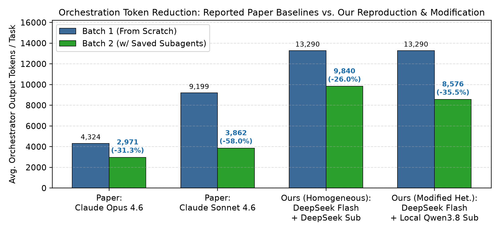

# AgentFactory — Reproducibility & Heterogeneous Local-SLM Subagent Study (FTEC5660)

> **Reproducibility fork of [zzatpku/AgentFactory](https://github.com/zzatpku/AgentFactory)** (*ACL 2026 System Demonstrations*, [arXiv:2603.18000](https://arxiv.org/abs/2603.18000)).  
> Full report & figures: [`report/REPRODUCIBILITY_REPORT.pdf`](report/REPRODUCIBILITY_REPORT.pdf) | [`report/REPRODUCIBILITY_REPORT.md`](report/REPRODUCIBILITY_REPORT.md)

## Overview of Reproduction & Modification

AgentFactory preserves successful task solutions as **executable Python subagents** (`SKILL.md` + `.py`) rather than textual reflections. In this reproducibility study, we:

1. **Replaced Proprietary Models & Search Backends (Edge Case A):**
   - **Meta-Agent:** **DeepSeek V4.1 Flash 1017** (`model="deepseek-flash"`, `https://api.deepseek.com`).
   - **Web Search & Fetch:** Replaced commercial Serper + Jina APIs with DeepSeek's native Search (`POST /v1/tools/search`) and Fetch (`POST /v1/tools/fetch`) endpoints while keeping `search_serper` / `read_url_jina` function signatures intact for subagent compatibility.
2. **Added Missing Evaluation & Reliability Instrumentation:**
   - Role-isolated token accounting (`LLM_ROLE=meta` vs. `subagent`) inside `llm.py` and `meta_tools.py` to measure Table 1's exact metric (`meta_completion_tokens`).
   - Process-isolated batch runner (`run_eval_batch.py`) with per-task timeouts, `--skip`, and automatic `summary.json` aggregation.
   - Fixed upstream bugs: `iteration == 1` `max_tokens=200` truncation (`meta_agent.py`), missing `trajectory.json` on 60-turn `[Auto-stop]`, and headless Playwright Chromium compatibility.
3. **Evaluated an Isolated Architectural Modification (Heterogeneous Local-SLM Subagents):**
   - Offloaded 100% of subagent execution from cloud `deepseek-flash` to a local quantized **`Qwen3.8-27B-Q4_K_M`** server (Strata / `llama-server` on `127.0.0.1:8080/v1`, dual RTX 5070 Ti GPUs) with `enable_thinking=False` to prevent reasoning-token starvation.

### Key Results Summary

| Configuration | Meta-Agent | Subagent | Batch 1 Avg. Meta Tokens | Batch 2 Avg. Meta Tokens | B1 → B2 Reduction | Batch 2 Time |
|---|---|---|---:|---:|---:|---:|
| **Paper (Table 1)** | Claude Opus 4.6 | Claude Opus 4.6 | 4,324 | 2,971 | -31.3% | — |
| **Paper (Table 1)** | Claude Sonnet 4.6 | Claude Sonnet 4.6 | 9,199 | 3,862 | -58.0% | — |
| **Ours (Homogeneous Control)** | `deepseek-flash` | `deepseek-flash` (Cloud) | 13,290 *(12 paired)* | **9,840** | **-26.0%** | 70.8 min |
| **Ours (Heterogeneous Modified)** | `deepseek-flash` | Local `Qwen3.8-27B` | 13,290 *(12 paired)* | **8,576** | **-35.5%** | **40.5 min** |

<p align="center">
  
</p>

---

## Quick Start (Install & Run Steps)

### 1. Environment & Dependencies

```bash
conda create -n agentfactory python=3.12 -y
conda activate agentfactory
pip install openai requests python-dotenv playwright matplotlib numpy scipy av gTTS edge-tts faster-whisper flask flask-cors
playwright install chromium
```

### 2. Start Local Subagent LLM (for Heterogeneous Mode)

Start **Qwen3.8-27B-Q4_K_M** via Strata or `llama-server` on `http://127.0.0.1:8080/v1` (verify with `curl http://127.0.0.1:8080/health`).

### 3. Configure `.env` (Never Committed)

Copy `.env.example` to `.env` and set your DeepSeek API key:

```bash
cp .env.example .env
```

```ini
# Meta Agent (DeepSeek V4.1 Flash 1017)
META_AGENT_URL=https://api.deepseek.com
META_AGENT_API_KEY=sk-your-deepseek-key
META_AGENT_MODEL=deepseek-flash
META_AGENT_PROTOCOL=OPENAI_STYLE

# Subagent (Local Qwen3.8 via Strata / llama-server)
SUBAGENT_URL=http://127.0.0.1:8080/v1
SUBAGENT_API_KEY=none
SUBAGENT_MODEL=Qwen3.8-27B-Q4_K_M
SUBAGENT_PROTOCOL=OPENAI_STYLE

# Used by tools.py for DeepSeek Search & Fetch
DEEPSEEK_API_KEY=sk-your-deepseek-key
```

### 4. Replace Audio Placeholder Paths in Question Files

Replace `<Absolute_Path_to_AgentFactory>` in `data/questions/*.jsonl` with your local clone path:

```bash
sed -i "s|<Absolute_Path_to_AgentFactory>|$(pwd)|g" data/questions/*.jsonl
```

### 5. Run Reproduction & Ablation Suites

**Step A — Clean From-Scratch Batch 1 (15 tasks):**
```bash
# Start with an empty subagent skill directory (archive pre-bundled demos first)
mkdir -p paper_demo_subagents
mv skills/subagents/tencent_docs_final skills/subagents/audio_transcriber paper_demo_subagents/ 2>/dev/null || true

python3 -u run_eval_batch.py \
  --question-file data/questions/questions_round1.jsonl \
  --tag batch1 \
  --timeout 3000
```

**Step B — Batch 2 Transfer Evaluation with Local Qwen3.8 Subagents (excluding login-gated Q2/Q12 & Q10):**
```bash
python3 -u run_eval_batch.py \
  --question-file data/questions/questions_round2.jsonl \
  --tag batch2 \
  --skip 2 --skip 10 --skip 12 \
  --timeout 3000
```

**Step C — Controlled Homogeneous Cloud Baseline (`Meta = Subagent = deepseek-flash`):**
```bash
# Restore exact 30-skill post-Batch-1 snapshot before running control
rm -rf skills/subagents && cp -r evaluations/snapshots/subagents_after_batch1 skills/subagents

python3 -u run_eval_batch.py \
  --question-file data/questions/questions_round2.jsonl \
  --tag batch2_homogeneous_ds \
  --skip 2 --skip 10 --skip 12 \
  --subagent-url https://api.deepseek.com \
  --subagent-key "$DEEPSEEK_API_KEY" \
  --subagent-model deepseek-flash \
  --timeout 1800
```

---

## Repository Structure & Saved Artifacts

- `evaluations/20261111T131822Z_batch1/summary.json` — Measured Batch 1 per-task tokens & latency.
- `evaluations/20261111T181845Z_batch2/summary.json` — Measured Batch 2 results (Heterogeneous: DeepSeek Meta + Local Qwen3.8 Sub).
- `evaluations/20261112T124719Z_batch2_homogeneous_ds/summary.json` — Measured Batch 2 results (Homogeneous DeepSeek Control).
- `evaluations/snapshots/` — Frozen skill-library snapshots (`subagents_after_batch1` with 30 skills; `subagents_after_batch2_qwen` with 46 skills).
- `report/REPRODUCIBILITY_REPORT.pdf` — 8-page self-contained reproducibility report (`<= 10` pages) + source Markdown & figures.

## Upstream Citation

```bibtex
@inproceedings{zhang-etal-2026-agentfactory,
    title = "{A}gent{F}actory: A Self-Evolving Framework Through Executable Subagent Accumulation and Reuse",
    author = "Zhang, Zhang and Lu, Shuqi and Qian, Hongjin and He, Di and Liu, Zheng",
    booktitle = "Proceedings of the 64th Annual Meeting of the Association for Computational Linguistics (Volume 3: System Demonstrations)",
    year = "2026",
    url = "https://aclanthology.org/2026.acl-demo.81/",
    pages = "819--828"
}
```
